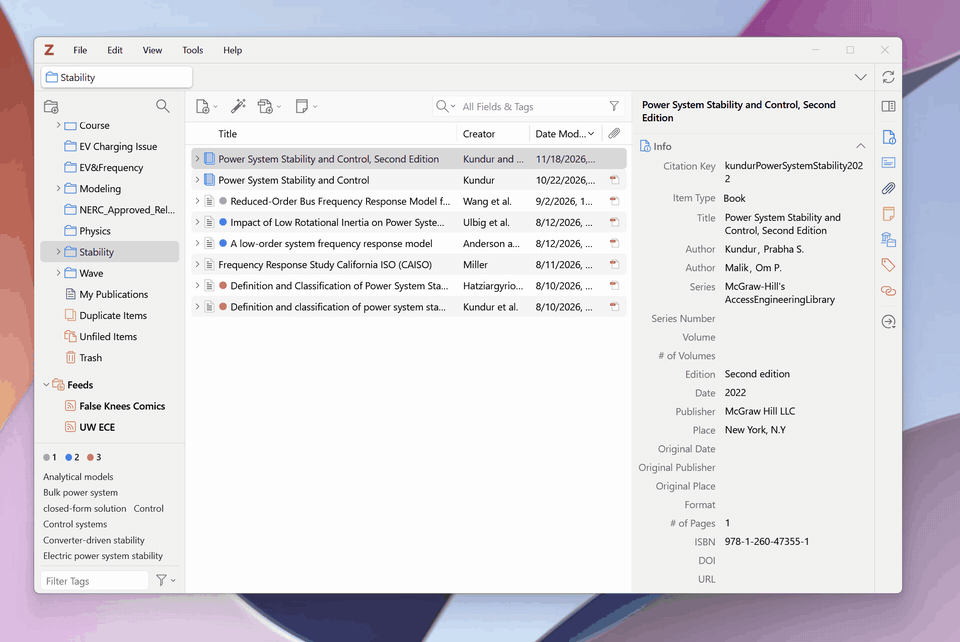

# Citekey Import Bridge

Part of **Zotero Obsidian Bridge**. [中文说明](README.zh-CN.md)

**Right-click a paper in Zotero, and Obsidian creates a literature note for it and opens it in a new tab.** Later, one more right-click in Zotero takes you back to that note.



## What it solves

If you manage papers in Zotero and take notes in Obsidian, the usual routine is: switch to Obsidian, open the command palette, run Zotero Integration, and search again for the paper you were just looking at in Zotero. To get from Zotero back to the note later, you have to go find it in Obsidian.

This project turns all of that into one right-click in Zotero:

| Context menu | What it does |
| --- | --- |
| **Create and Link Obsidian Note** | Creates the note in Obsidian, opens it, and saves the note link on the Zotero item |
| **Open Obsidian Note** | Opens the linked note in a new Obsidian tab |
| **Remove Saved Obsidian Link** | Removes only the link saved in Zotero, not the note. Use it to re-link |

While reading in the PDF reader you don't need to go back to the library: right-click the **reader tab** or the **PDF page** to open or create the note for that paper.

The project has two small plugins that work together: one for Zotero (**Zotero Citekey Bridge**) and one for Obsidian (**Citekey Import Bridge**).

## What you need

- [Zotero](https://www.zotero.org/download/) 7 or later
- [Obsidian](https://obsidian.md/download) desktop (Windows / macOS / Linux; the mobile app is not supported)
- About 20 minutes

You will also install two existing plugins: [Better BibTeX](https://retorque.re/zotero-better-bibtex/installation/) for Zotero and [Zotero Integration](https://github.com/mgmeyers/obsidian-zotero-integration) for Obsidian. The steps below cover both.

## Quick start

Everything below uses the default names. **Don't rename anything on your first setup.** Get it working first, then change names as described in [Customization](docs/en/customize.md).

| Name | Default |
| --- | --- |
| Obsidian vault name | `ObsidianVault` |
| Literature note folder | `ZoteroLib` |
| Import format name | `Paper Note` |

For screenshots and details of every step, see the [Install guide](docs/en/install.md).

1. **Zotero: install Better BibTeX.** It gives every item a unique citekey, such as `smithDeepLearning2024`.
   You should see: when you select an item in Zotero, the item pane on the right shows `Citation Key`.
2. **Obsidian: create a vault named `ObsidianVault` with a folder `ZoteroLib` in it.**
   You should see: `ObsidianVault` at the bottom left of Obsidian, and `ZoteroLib` in the file list.
3. **Obsidian: install and enable Zotero Integration.** Settings → Community plugins → Turn on community plugins → Browse, then search for `Zotero Integration`.
4. **Obsidian: add the note template and create the import format `Paper Note`.** Copy this project's [template](docs/zh/template/paper-note-template.md) into your vault, then add an Import Format in the Zotero Integration settings:
   - Name: `Paper Note`
   - Output Path: `ZoteroLib/{{citekey}}.md`
   - Template File: the template you just copied

   You should see: press `Ctrl+P` (`Cmd+P` on macOS), run `Zotero Integration: Paper Note`, pick a paper, and a new note appears in `ZoteroLib`. **If this step fails, nothing after it will work.**
5. **Obsidian: install Citekey Import Bridge.** Download `citekey-import-bridge-<version>.zip` from [Releases](https://github.com/KeiYuHin/zotero-obsidian-bridge/releases/latest), extract it to `ObsidianVault/.obsidian/plugins/citekey-import-bridge/`, and enable it under Community plugins.
6. **Zotero: install Zotero Citekey Bridge.** Download `zotero-citekey-bridge-<version>.xpi` from [Releases](https://github.com/KeiYuHin/zotero-obsidian-bridge/releases/latest). In Zotero, go to Tools → Plugins → gear icon → Install Plugin From File and pick it.
   You should see: `Citekey Bridge` in the left sidebar of Zotero's Settings window.
7. **Try it.** Keep both Zotero and Obsidian open. In Zotero, right-click a paper → **Create and Link Obsidian Note**.
   You should see: Obsidian comes to the front and opens the paper's note in a new tab, and the item's `Extra` field in Zotero gains a line `Obsidian Link: ...`.

## Everyday use

- **Starting a new paper**: right-click → Create and Link Obsidian Note.
- **Going back to the note**: right-click → Open Obsidian Note. The note template also has a `Goto Zotero` link to jump from the note back to Zotero.
- **Taking notes while reading the PDF**: right-click the reader tab or the PDF page. Linked papers show "Open Obsidian Note"; unlinked papers show "Create and Link Obsidian Note". The tab menu needs Zotero 8 or later; the PDF page menu works from Zotero 7.
- **Regenerating a note**: right-click → Remove Saved Obsidian Link, then create again. Anything you wrote inside the template's `persist` block is kept; see the [Template guide](docs/en/template/README.md).

In the item list, the menu works only when **exactly one regular item** is selected. With an attachment, a standalone note, or several items selected, the menu is greyed out. For items not linked yet, "Open" and "Remove" are greyed out too.

In the reader, the note belongs to the PDF's parent item. A standalone PDF with no parent item shows no menu. "Remove Saved Obsidian Link" is only in the item list's context menu.

## Troubleshooting

The three most common causes:

1. **Zotero isn't running.** Obsidian reads data from Zotero during the import, so Zotero must be open.
2. **The names don't match.** The vault name, folder, and import format name in the Zotero settings must exactly match Obsidian, including case and spaces.
3. **Step 4 didn't work.** First make sure running `Zotero Integration: Paper Note` manually in Obsidian creates a note.

For everything else, see [Troubleshooting](docs/en/troubleshooting.md).

## More docs

- [Install guide](docs/en/install.md): every step in detail
- [Customization](docs/en/customize.md): change the vault name, folder, import format name, or template
- [Troubleshooting](docs/en/troubleshooting.md): find the cause by symptom
- [Template guide](docs/en/template/README.md): what each part of the template does
- [Developer docs](docs/zh/dev/README.md) (Chinese): how it works, the URL interface, packaging and releases

## For developers

The two plugins share one version number and are released together. Their sources are in `plugins/zotero/` and `plugins/obsidian/`.

```sh
make release VERSION=0.3.0
# without make:
node scripts/release.mjs --version 0.3.0
```

This syncs the version into every manifest and writes the Zotero `.xpi` and `zotero-updates.json`, plus the Obsidian `main.js`, `manifest.json`, `versions.json`, and a zip, to `release/<version>/`. Pushing a tag such as `0.3.0` (no `v` prefix) makes GitHub Actions build and publish the release. See the [developer docs](docs/zh/dev/README.md#打包与发版) for the full release steps.

Notes:

- The Obsidian plugin ID is `citekey-import-bridge`. Obsidian's community-plugin rules don't allow the word `obsidian` in plugin IDs.
- Citekey Import Bridge calls Zotero Integration's `runImport()`. It works well for this workflow but is not a formally stable public API, so a future Zotero Integration update may need a small compatibility fix.
- The Zotero plugin supports Zotero 7 through 10. The reader-tab menu uses `Zotero.MenuManager`, which Zotero 8 introduced, and is skipped on Zotero 7.

## License

MIT
