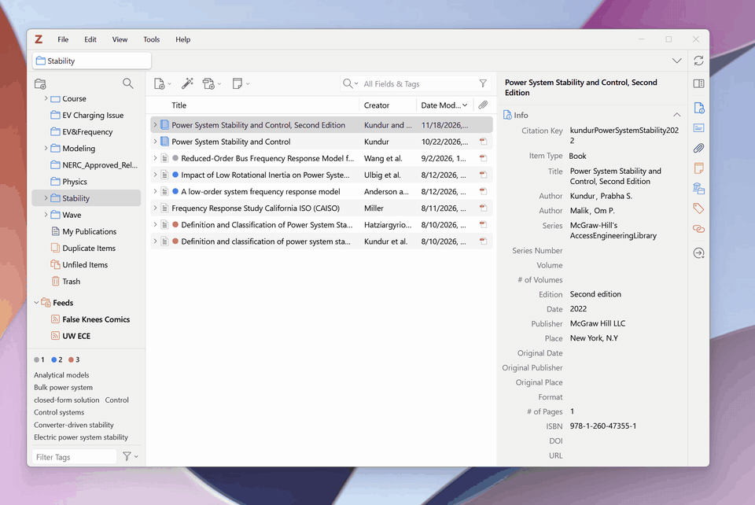

# Zotero Obsidian Bridge

[English](README.md)

**在 Zotero 里右键一篇文献，Obsidian 会自动生成这篇文献的笔记，并在新标签页打开。** 以后在 Zotero 里右键一下，就能回到这篇笔记。

## 它解决什么问题

用 Zotero 管文献、用 Obsidian 记笔记的人，通常要这样操作：切到 Obsidian，打开命令面板，运行 Zotero Integration，再搜索一遍刚才在 Zotero 里看的那篇文献。下次想从 Zotero 回到笔记时，还得去 Obsidian 里找。

这个项目把整个过程变成 Zotero 里的一次右键：

| 右键菜单 | 作用 |
| --- | --- |
| **创建并关联 Obsidian 笔记** | 在 Obsidian 中生成笔记并打开，同时把笔记链接存进这条文献 |
| **打开 Obsidian 笔记** | 在 Obsidian 新标签页打开已关联的笔记 |
| **删除已保存的 Obsidian 链接** | 只删除 Zotero 里存的链接，不删笔记。用于重新关联 |

在 PDF 阅读器里读文献时，不用退回文献库：右键**阅读器标签页**或 **PDF 页面**，就能打开或创建这篇文献的笔记。

项目包含两个小插件，需要配套使用：一个装在 Zotero 里（Zotero Citekey Bridge），一个装在 Obsidian 里（Citekey Import Bridge）。

## 开始前你需要准备

- [Zotero](https://www.zotero.org/download/) 7 或更新版本
- [Obsidian](https://obsidian.md/download) 桌面版（Windows / macOS / Linux，手机版不支持）
- 大约 20 分钟

下面还会安装两个现成的插件：Zotero 里的 [Better BibTeX](https://retorque.re/zotero-better-bibtex/installation/)，Obsidian 里的 [Zotero Integration](https://github.com/mgmeyers/obsidian-zotero-integration)。步骤里都有说明。

## 快速开始

下面全部使用默认名字。**第一次配置请不要改名**，先跑通，再按 [自定义设置](docs/zh/customize.md) 改。

| 名字 | 默认值 |
| --- | --- |
| Obsidian 库名（vault） | `ObsidianVault` |
| 文献笔记文件夹 | `ZoteroLib` |
| 导入格式名（Import Format） | `Paper Note` |

每一步的详细图文说明见 [安装指南](docs/zh/install.md)。

1. **Zotero：安装 Better BibTeX。** 它负责给每篇文献生成一个唯一的 citekey，例如 `smithDeepLearning2024`。
   做完你应该看到：在 Zotero 中点开一篇文献，右侧信息栏里有 `Citation Key`。
2. **Obsidian：新建一个名为 `ObsidianVault` 的库，并在里面建一个文件夹 `ZoteroLib`。**
   做完你应该看到：Obsidian 左下角显示 `ObsidianVault`，左侧文件列表里有 `ZoteroLib`。
3. **Obsidian：安装并启用 Zotero Integration。** 设置 → 第三方插件 → 关闭安全模式 → 浏览，搜索 `Zotero Integration`。
4. **Obsidian：放入笔记模板，并新建导入格式 `Paper Note`。** 把本项目的 [模板](docs/zh/template/paper-note-template.md) 复制进库里，然后在 Zotero Integration 设置中添加 Import Format：
   - Name：`Paper Note`
   - Output Path：`ZoteroLib/{{citekey}}.md`
   - Template File：选择刚才复制的模板

   做完你应该看到：在 Obsidian 中按 `Ctrl+P`（macOS 为 `Cmd+P`），运行 `Zotero Integration: Paper Note`，选一篇文献后，`ZoteroLib` 里出现一篇新笔记。**这一步不成功，后面也不会成功。**
5. **Obsidian：安装 Citekey Import Bridge。** 从 [Releases](https://github.com/KeiYuHin/zotero-obsidian-bridge/releases/latest) 下载 `citekey-import-bridge-版本号.zip`，解压到 `ObsidianVault/.obsidian/plugins/citekey-import-bridge/`，然后在第三方插件里启用。
6. **Zotero：安装 Zotero Citekey Bridge。** 从 [Releases](https://github.com/KeiYuHin/zotero-obsidian-bridge/releases/latest) 下载 `zotero-citekey-bridge-版本号.xpi`，在 Zotero 的 工具 → 插件 → 齿轮图标 → 从文件安装插件 中选择它。
   做完你应该看到：Zotero 设置窗口左侧多了 `Citekey Bridge`。
7. **试一下。** 保持 Zotero 和 Obsidian 都打开。在 Zotero 中右键一篇文献 → **创建并关联 Obsidian 笔记**。
   做完你应该看到：Obsidian 弹到前台，在新标签页打开这篇文献的笔记；Zotero 中这条文献的 `Extra` 字段多了一行 `Obsidian Link: ...`。

## 日常使用

- **新读一篇文献**：右键 → 创建并关联 Obsidian 笔记。
- **回到笔记**：右键 → 打开 Obsidian 笔记。笔记模板里也有 `Goto Zotero` 链接，可以从笔记跳回 Zotero。
- **边读 PDF 边记**：在阅读器里右键标签页或 PDF 页面。已关联的文献显示“打开 Obsidian 笔记”，没关联的显示“创建并关联 Obsidian 笔记”。标签页右键需要 Zotero 8 或更新版本，PDF 页面右键 Zotero 7 起就有。
- **重新生成笔记**：右键 → 删除已保存的 Obsidian 链接，再创建一次。模板里 `persist` 区块内你写的内容会保留，详见 [模板说明](docs/zh/template/README.md)。

在文献列表里，只选中**一条普通文献**时菜单才可用。附件、独立笔记、多选时菜单是灰色的；还没关联过的文献，“打开”和“删除”两项也是灰色的。

在阅读器里，笔记关联在 PDF 所属的父文献上。没有父文献的独立 PDF 不显示这些菜单。“删除已保存的 Obsidian 链接”只在文献列表的右键菜单里有。

## 遇到问题

最常见的三个原因：

1. **Zotero 没打开。** Obsidian 导入时要从 Zotero 读数据，Zotero 必须在运行。
2. **名字没对上。** Zotero 端设置里的库名、文件夹、导入格式名，要和 Obsidian 里的完全一样，包括大小写和空格。
3. **第 4 步没跑通。** 先确认在 Obsidian 里手动运行 `Zotero Integration: Paper Note` 能生成笔记。

其他情况见 [常见问题](docs/zh/troubleshooting.md)。

## 更多文档

- [安装指南](docs/zh/install.md)：每一步的详细说明
- [自定义设置](docs/zh/customize.md)：改库名、文件夹、导入格式名、模板
- [常见问题](docs/zh/troubleshooting.md)：按症状查原因
- [模板说明](docs/zh/template/README.md)：模板里每一部分的作用
- [开发者文档](docs/zh/dev/README.md)：工作原理、URL 接口、打包发版

## 许可证

MIT
