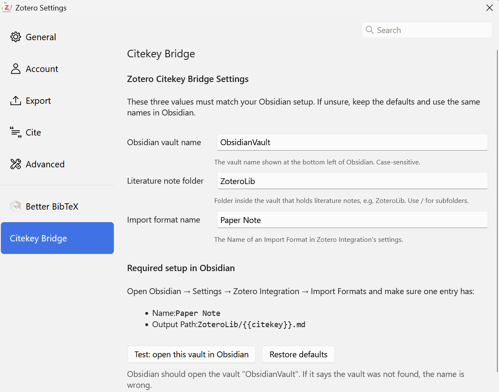

# Customization

Get everything working with the default names first, following the [Install guide](install.md), then come back here. The three names below **must match on both sides**: if you change one side, change the other too.

| Name | Zotero side (Citekey Bridge settings) | Obsidian side |
| --- | --- | --- |
| Vault | Obsidian vault name | The vault name shown at the bottom left of Obsidian |
| Folder | Literature note folder | The part before `{{citekey}}.md` in Zotero Integration → Import Format → Output Path |
| Import format | Import format name | Zotero Integration → Import Format → Name |

The Zotero settings are under **Edit → Settings → Citekey Bridge** on Windows / Linux, and **Zotero → Settings → Citekey Bridge** on macOS. The bottom of the pane shows, as you type, what the Obsidian side should be. Use it to double-check.

> 中文版见 [自定义设置](../zh/customize.md)。

## Use an existing vault

1. Zotero side: change **Obsidian vault name** to your vault's name, for example `Research`.
2. Click **Test: open this vault in Obsidian** and make sure Obsidian opens the right vault.

Vault names are case-sensitive, and spaces count.

## Change the literature note folder

For example, to keep notes in `Literature/Papers`:

1. Obsidian side: create the folder `Literature/Papers` in your vault.
2. Obsidian side: change the Import Format's Output Path to `Literature/Papers/{{citekey}}.md`.
3. Zotero side: change **Literature note folder** to `Literature/Papers`. Separate subfolders with `/`, with no `/` at the start or end.

If the two sides don't match, Obsidian shows a warning after the import with both paths.

## Change the import format name

For example, if you already have an import format named `Literature Note` and want to use it:

1. Zotero side: change **Import format name** to `Literature Note`.
2. Make sure that import format's Output Path has the form `folder/{{citekey}}.md`, with the same folder as the Zotero side.

If the Output Path uses variables other than `{{citekey}}` (for example `{{year}}/{{citekey}}.md`), notes are still created, but "Open Obsidian Note" in Zotero won't find them. Keep the `folder/{{citekey}}.md` form.

## Items linked before you changed the settings

Settings only affect links created **from now on**. Items linked earlier still have the old path in `Extra`.

If you moved notes or renamed the vault, "Open Obsidian Note" stops working for those older items. To fix them one by one: right-click → **Remove Saved Obsidian Link**, then → **Create and Link Obsidian Note**. Anything in the note's `persist` block is kept (see the [Template guide](template/README.md)).

## Change the template

See the [Template guide](template/README.md). If you changed the vault name or folder, also update `ObsidianVault` and `ZoteroLib` in the template's `Goto Obsidian` link.

## Restore defaults

In Zotero's Citekey Bridge settings, click **Restore defaults**. The three values go back to `ObsidianVault`, `ZoteroLib`, and `Paper Note`.
