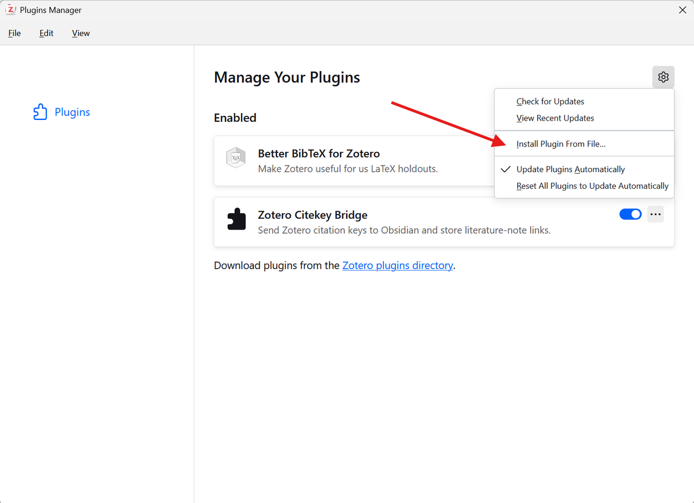
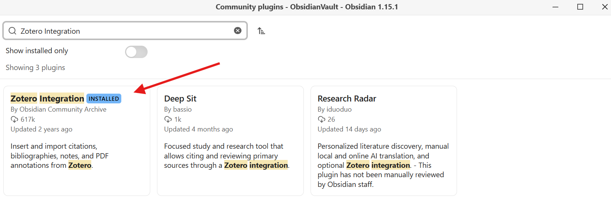
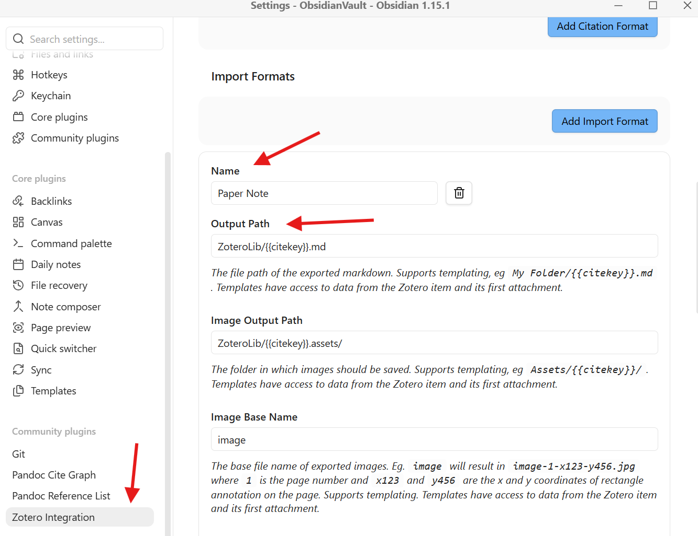
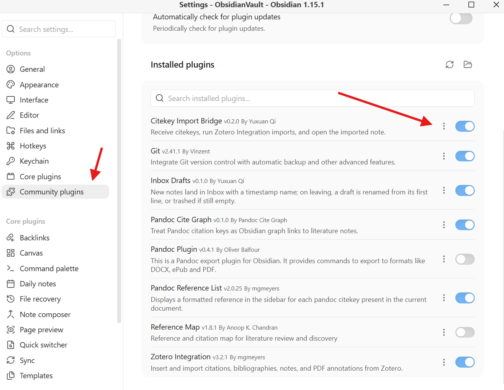
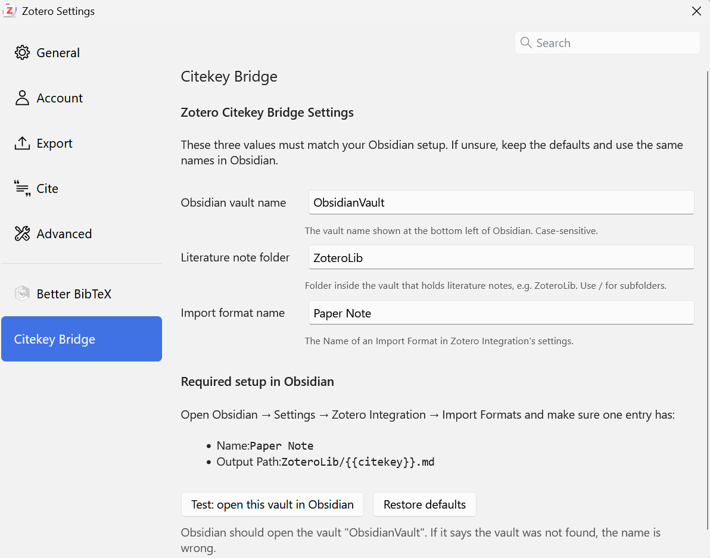

# Install guide

This guide is for people who **have used Zotero but have never installed an Obsidian plugin**. Follow the steps in order. Each step ends with a **Check**; make sure it passes before moving on.

The guide uses the default names throughout. Don't rename anything on your first setup. Get it working first, then see [Customization](customize.md).

| Name | Default | Used in |
| --- | --- | --- |
| Obsidian vault name | `ObsidianVault` | Steps 2 and 7 |
| Literature note folder | `ZoteroLib` | Steps 2 and 5 |
| Import format name | `Paper Note` | Step 5 |

> Menu names follow the English interface. 中文版见 [安装指南](../zh/install.md)。

## Contents

1. [Zotero: install Better BibTeX](#1-zotero-install-better-bibtex)
2. [Obsidian: create the vault and folder](#2-obsidian-create-the-vault-and-folder)
3. [Obsidian: install Zotero Integration](#3-obsidian-install-zotero-integration)
4. [Obsidian: add the note template](#4-obsidian-add-the-note-template)
5. [Obsidian: create the import format Paper Note](#5-obsidian-create-the-import-format-paper-note)
6. [Obsidian: install Citekey Import Bridge](#6-obsidian-install-citekey-import-bridge)
7. [Zotero: install Zotero Citekey Bridge](#7-zotero-install-zotero-citekey-bridge)
8. [Try it](#8-try-it)

---

## 1. Zotero: install Better BibTeX

Better BibTeX gives every item a unique **citekey** (for example `smithDeepLearning2024`). This project uses the citekey to decide which note belongs to which paper.

1. Open the [Better BibTeX releases page](https://github.com/retorquere/zotero-better-bibtex/releases/latest) and download `zotero-better-bibtex-<version>.xpi`.
   In Firefox, clicking the link tries to install it as a browser add-on, so **right-click → Save Link As** instead.
2. In Zotero, open **Tools → Plugins**.
3. Click the **gear icon** at the top right → **Install Plugin From File**, and pick the `.xpi` you downloaded.
4. Restart Zotero if asked.



**Check**: select any item in Zotero. The item pane on the right shows `Citation Key` followed by a string.

---

## 2. Obsidian: create the vault and folder

An Obsidian "vault" is just an ordinary folder on your computer. Notes are stored in it as `.md` files.

1. Open Obsidian. If this is your first time, choose **Create new vault** on the welcome screen. If you already have a vault, click the vault name at the bottom left → **Manage vaults** → **Create**.
2. Enter `ObsidianVault` as the vault name, choose any location, and click Create.
3. Right-click an empty area of the file list on the left → **New folder**, and name it `ZoteroLib`.

> Already have a vault you'd rather use? That's fine, but note its name: you will enter it in the Zotero settings in step 7.

**Check**: `ObsidianVault` shows at the bottom left of Obsidian, and the file list has a `ZoteroLib` folder.

---

## 3. Obsidian: install Zotero Integration

Zotero Integration is an existing Obsidian plugin. It reads item data from Zotero and creates notes from a template. This project only starts the import from Zotero; Zotero Integration does the actual note creation.

1. Open Obsidian **Settings** (gear icon at the bottom left) → **Community plugins**.
2. Click **Turn on community plugins**. Older versions call this "Turn off Restricted mode".
3. Click **Browse** next to Community plugins, and search for `Zotero Integration` by mgmeyers.
4. Click **Install**, then **Enable**.



**Check**: `Zotero Integration` appears at the bottom of the Settings sidebar.

---

## 4. Obsidian: add the note template

The template decides what a note looks like: title, authors, journal, DOI, jump links, and the area where you write your own notes.

1. Create a folder named `Templates` in your vault (any name works).
2. In `Templates`, create a note named `Paper Note Template`.
3. Open this project's [paper-note-template.md](../zh/template/paper-note-template.md), click **Raw** at the top right of the GitHub page, select everything, copy it, and paste it into that note.

> After pasting, Obsidian may show the opening `---` block as a "Properties" panel. That's normal.

What each part of the template does: [Template guide](template/README.md).

**Check**: your vault has `Templates/Paper Note Template.md`, and it starts with `---` and `title: "{{title}}"`.

---

## 5. Obsidian: create the import format Paper Note

An "Import Format" is a Zotero Integration configuration: which template to use and where to save the note. This project calls the import format named `Paper Note` by default.

1. Open **Settings → Zotero Integration**.
2. Under **Import Formats**, click **Add Import Format**.
3. Fill in:

   | Field | Value |
   | --- | --- |
   | Name | `Paper Note` |
   | Output Path | `ZoteroLib/{{citekey}}.md` |
   | Template File | `Templates/Paper Note Template.md` |

   Leave the other fields at their defaults. `Paper Note` has one space in the middle, and the case must match.



**Check (important)**:

1. Make sure Zotero is running.
2. In Obsidian, press `Ctrl+P` (`Cmd+P` on macOS) to open the command palette, type `Paper Note`, and run **Zotero Integration: Paper Note**.
3. Pick a paper in the Zotero search box that pops up.
4. A new note named after the citekey appears in `ZoteroLib`, with the template filled in.

**If this step fails, nothing after it will work.** If it fails, see [Troubleshooting: manual import with Zotero Integration fails](troubleshooting.md#manual-import-with-zotero-integration-fails).

You can keep or delete the test note.

---

## 6. Obsidian: install Citekey Import Bridge

This is the Obsidian half of this project. Until it is available in the community plugin browser, install it by hand into the plugins folder.

1. Open this project's [Releases page](https://github.com/KeiYuHin/zotero-obsidian-bridge/releases/latest), download `citekey-import-bridge-<version>.zip`, and extract it. You should get `main.js` and `manifest.json`.
2. Open Obsidian **Settings → Community plugins** and click the **folder icon** next to **Installed plugins**. This opens your vault's `.obsidian/plugins` folder.
   > `.obsidian` is a hidden folder, so use this button rather than looking for it yourself.
3. In `plugins`, create a folder `citekey-import-bridge` and put `main.js` and `manifest.json` in it:

   ```text
   ObsidianVault/
   └── .obsidian/
       └── plugins/
           └── citekey-import-bridge/
               ├── main.js
               └── manifest.json
   ```

4. Back in Obsidian, click the **refresh icon** next to **Installed plugins**, find **Citekey Import Bridge** in the list, and turn it on.



**Check**: in the Installed plugins list, the toggle for Citekey Import Bridge is on.

---

## 7. Zotero: install Zotero Citekey Bridge

This is the Zotero half of this project. It adds the context menu items.

1. Open this project's [Releases page](https://github.com/KeiYuHin/zotero-obsidian-bridge/releases/latest) and download `zotero-citekey-bridge-<version>.xpi`. In Firefox, again use **right-click → Save Link As**.
2. In Zotero, open **Tools → Plugins**, click the **gear icon** → **Install Plugin From File**, and pick the `.xpi`.
3. Open Zotero's settings: **Edit → Settings** on Windows / Linux, **Zotero → Settings** on macOS.
4. Click **Citekey Bridge** on the left and check the three settings:

   | Setting | Value |
   | --- | --- |
   | Obsidian vault name | The vault name from step 2, default `ObsidianVault` |
   | Literature note folder | `ZoteroLib` |
   | Import format name | `Paper Note` |

5. Click **Test: open this vault in Obsidian**.



**Check**: after clicking the test button, Obsidian comes to the front and shows your vault. If Obsidian says the vault was not found, the vault name is wrong; compare it with the name at the bottom left of Obsidian.

---

## 8. Try it

1. Keep both Zotero and Obsidian open.
2. In Zotero, select **one** paper, right-click → **Create and Link Obsidian Note**.

**Check**:

- Zotero shows "Sent to Obsidian" at the bottom right.
- Obsidian comes to the front, opens the paper's note in a new tab, and shows "Imported and opened" at the top right.
- In Zotero, the item's `Extra` field ends with a new line `Obsidian Link: obsidian://open?...`.

From now on, right-click → **Open Obsidian Note** takes you straight back to the note. While reading the PDF, you can also right-click the reader tab or the PDF page.

If everything passed, you're set. If not, see [Troubleshooting](troubleshooting.md).
