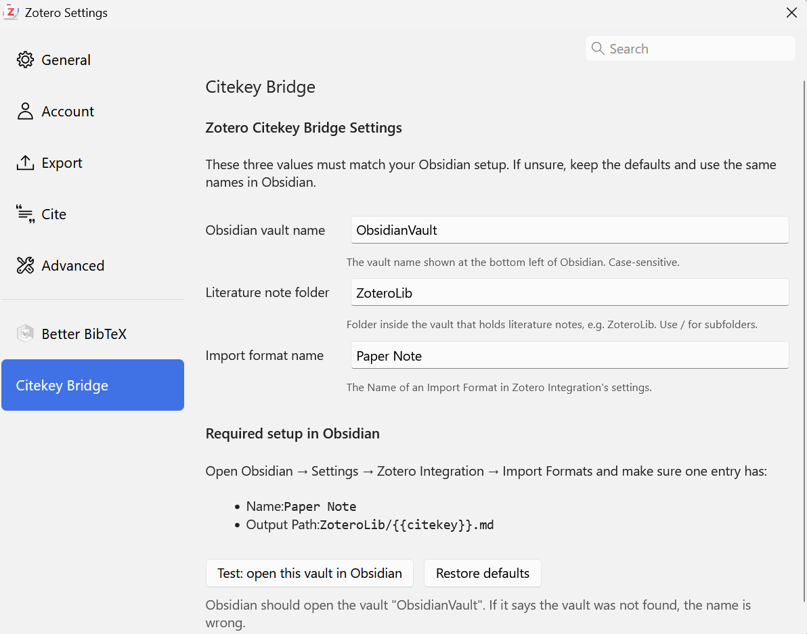

# 自定义设置

先按 [安装指南](install.md) 用默认名字跑通，再来改。下面三个名字**两边必须一致**，改了一边就要改另一边。

| 名字 | Zotero 端（Citekey Bridge 设置） | Obsidian 端 |
| --- | --- | --- |
| 库名 | Obsidian 库名 | Obsidian 左下角显示的库名 |
| 文件夹 | 文献笔记文件夹 | Zotero Integration → Import Format → Output Path 里 `{{citekey}}.md` 前面的部分 |
| 导入格式名 | 导入格式名 | Zotero Integration → Import Format → Name |

Zotero 端的设置在：Windows / Linux 为 **编辑 → 设置 → Citekey Bridge**，macOS 为 **Zotero → 设置 → Citekey Bridge**。面板下方会实时显示 Obsidian 端应该怎么填，照着核对即可。

## 用已有的库

1. Zotero 端：把 **Obsidian 库名** 改成你的库名，例如 `Research`。
2. 点击 **测试：在 Obsidian 中打开这个库**，确认 Obsidian 打开的是对的库。

库名区分大小写，空格也算。

## 改文献笔记文件夹

例如想把笔记放进 `Literature/Papers`：

1. Obsidian 端：在库里建好 `Literature/Papers` 文件夹。
2. Obsidian 端：把 Import Format 的 Output Path 改成 `Literature/Papers/{{citekey}}.md`。
3. Zotero 端：把 **文献笔记文件夹** 改成 `Literature/Papers`。子文件夹用 `/` 分隔，开头和结尾不要加 `/`。

两边对不上时，Obsidian 会在导入后弹出提醒，指出两边各是什么路径。

## 改导入格式名

例如你已经有一个叫 `Literature Note` 的导入格式，想直接用它：

1. Zotero 端：把 **导入格式名** 改成 `Literature Note`。
2. 确认这个导入格式的 Output Path 是 `文件夹/{{citekey}}.md` 的形式，并且文件夹和 Zotero 端一致。

Output Path 里如果还用了 `{{citekey}}` 以外的变量（例如 `{{year}}/{{citekey}}.md`），笔记能正常生成，但 Zotero 里的“打开 Obsidian 笔记”找不到它。请保持 `文件夹/{{citekey}}.md` 的形式。

## 改了设置以后，旧文献怎么办

设置只影响**之后新建**的链接。已经关联过的文献，`Extra` 里存的还是旧路径。

如果你移动了笔记、改了库名，旧文献的“打开 Obsidian 笔记”会失效。逐条修复的方法：右键 → **删除已保存的 Obsidian 链接**，再 → **创建并关联 Obsidian 笔记**。笔记里 `persist` 区块的内容会保留（见 [模板说明](template/README.md)）。

## 改模板

见 [模板说明](template/README.md)。如果改了库名或文件夹，记得把模板里 `Goto Obsidian` 链接中的 `ObsidianVault` 和 `ZoteroLib` 一起改掉。

## 恢复默认

Zotero 端 Citekey Bridge 设置里点击 **恢复默认**，三项回到 `ObsidianVault`、`ZoteroLib`、`Paper Note`。
