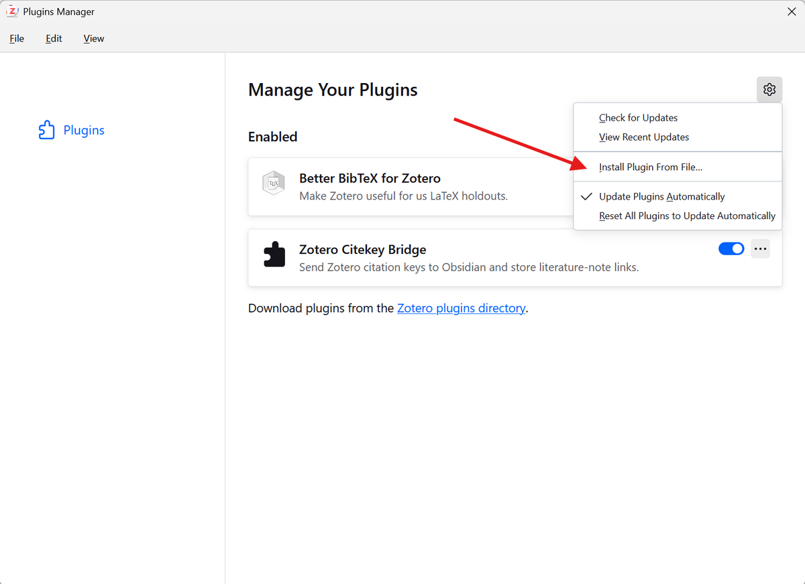
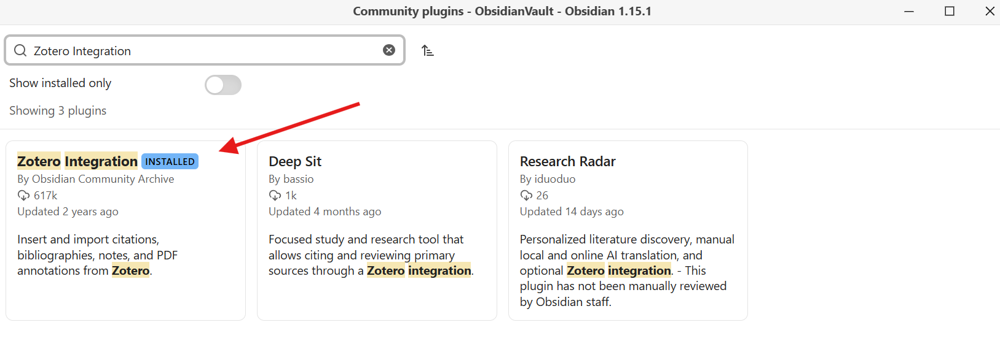
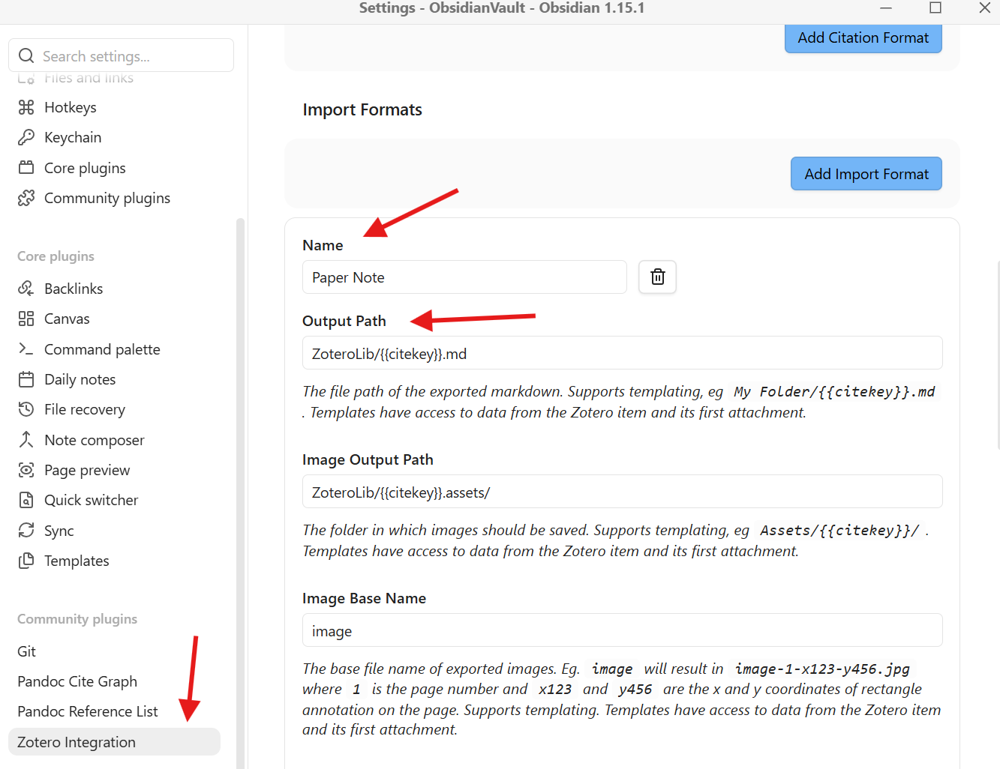
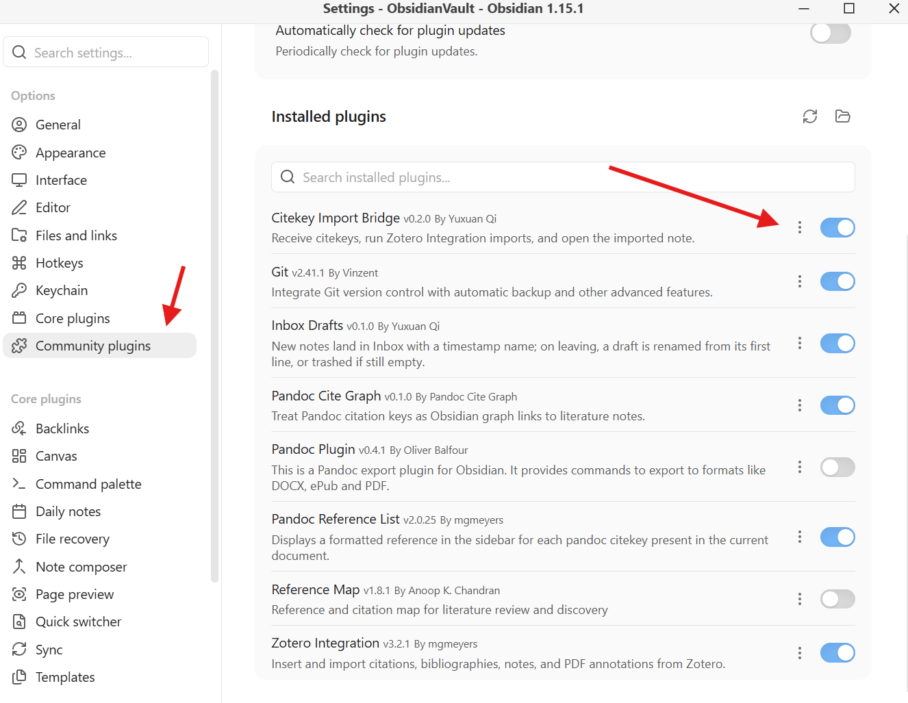
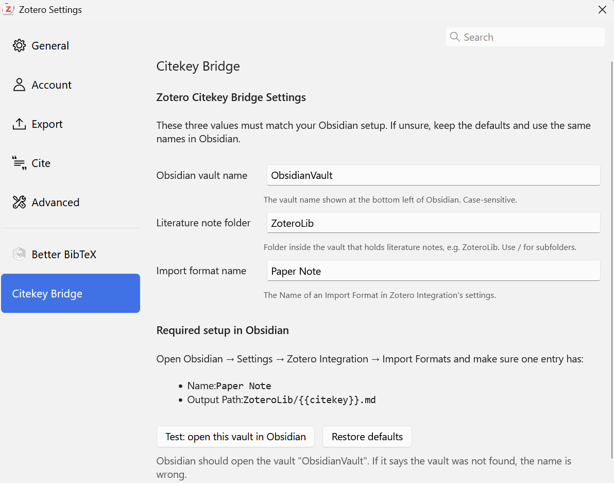

# 安装指南

这份指南写给**用过 Zotero、但没装过 Obsidian 插件**的人。按顺序做，每一步最后都有“检查”，确认通过再往下走。

全程使用默认名字。第一次配置请不要改名，先跑通，再看 [自定义设置](customize.md)。

| 名字 | 默认值 | 在哪里用到 |
| --- | --- | --- |
| Obsidian 库名（vault） | `ObsidianVault` | 第 2 步、第 7 步 |
| 文献笔记文件夹 | `ZoteroLib` | 第 2 步、第 5 步 |
| 导入格式名（Import Format） | `Paper Note` | 第 5 步 |

> 本文的菜单名以中文界面为准，括号里是英文界面的名字。

## 目录

1. [Zotero：安装 Better BibTeX](#1-zotero安装-better-bibtex)
2. [Obsidian：建库和文件夹](#2-obsidian建库和文件夹)
3. [Obsidian：安装 Zotero Integration](#3-obsidian安装-zotero-integration)
4. [Obsidian：放入笔记模板](#4-obsidian放入笔记模板)
5. [Obsidian：新建导入格式 Paper Note](#5-obsidian新建导入格式-paper-note)
6. [Obsidian：安装 Citekey Import Bridge](#6-obsidian安装-citekey-import-bridge)
7. [Zotero：安装 Zotero Citekey Bridge](#7-zotero安装-zotero-citekey-bridge)
8. [试一下](#8-试一下)

---

## 1. Zotero：安装 Better BibTeX

Better BibTeX 给每篇文献生成一个唯一的 **citekey**（例如 `smithDeepLearning2024`）。本项目用 citekey 来确定“哪篇文献对应哪篇笔记”。

1. 打开 [Better BibTeX 的 Releases 页面](https://github.com/retorquere/zotero-better-bibtex/releases/latest)，下载 `zotero-better-bibtex-版本号.xpi`。
   如果你用的是 Firefox，点击链接会被当成浏览器插件安装，请**右键 → 链接另存为**。
2. 在 Zotero 中打开 **工具 → 插件**（Tools → Plugins）。
3. 点击右上角的**齿轮图标** → **从文件安装插件**（Install Plugin From File），选择刚下载的 `.xpi`。
4. 按提示重启 Zotero。



**检查**：在 Zotero 中点开任意一篇文献，右侧信息栏里能看到 `Citation Key`，后面有一串字符。

---

## 2. Obsidian：建库和文件夹

Obsidian 里的“库”（vault）就是电脑上的一个普通文件夹，笔记都以 `.md` 文件存在里面。

1. 打开 Obsidian。如果是第一次用，在欢迎界面选择 **新建仓库**（Create new vault）。如果已经有库，点击左下角的库名 → **管理仓库**（Manage vaults）→ **新建**。
2. 仓库名填 `ObsidianVault`，位置任选，点击创建。
3. 在左侧文件列表空白处右键 → **新建文件夹**，命名为 `ZoteroLib`。

> 已经有自己的库、不想新建？可以直接用现有的库，但要记下它的名字，第 7 步要在 Zotero 设置里填进去。

**检查**：Obsidian 左下角显示 `ObsidianVault`，左侧文件列表里有 `ZoteroLib` 文件夹。

---

## 3. Obsidian：安装 Zotero Integration

Zotero Integration 是一个现成的 Obsidian 插件，负责从 Zotero 读取文献信息，再按模板生成笔记。本项目只负责“从 Zotero 发起调用”，真正生成笔记的是它。

1. 打开 Obsidian **设置**（左下角齿轮图标）→ **第三方插件**（Community plugins）。
2. 点击 **开启社区插件**（Turn on community plugins）。旧版本里这个按钮叫“关闭安全模式”。
3. 点击 **社区插件市场** 旁边的 **浏览**（Browse），搜索 `Zotero Integration`，作者是 mgmeyers。
4. 点击 **安装**（Install），装完点击 **启用**（Enable）。



**检查**：设置左侧栏最下面出现 `Zotero Integration`。

---

## 4. Obsidian：放入笔记模板

模板决定生成的笔记长什么样：标题、作者、期刊、DOI、跳转链接，以及你自己写笔记的区域。

1. 在库里新建一个文件夹 `Templates`（名字随意）。
2. 在 `Templates` 中新建笔记，命名为 `Paper Note Template`。
3. 打开本项目的 [paper-note-template.md](template/paper-note-template.md)，点击 GitHub 页面右上角的 **Raw**，全选复制，粘贴到这篇笔记里。

> 粘贴后 Obsidian 可能把开头的 `---` 区块显示成“属性”面板，这是正常的。

模板里每一部分的作用见 [模板说明](template/README.md)。

**检查**：库里有 `Templates/Paper Note Template.md`，内容以 `---` 和 `title: "{{title}}"` 开头。

---

## 5. Obsidian：新建导入格式 Paper Note

“导入格式”（Import Format）是 Zotero Integration 的一套配置：用哪个模板、笔记存到哪里。本项目默认调用名为 `Paper Note` 的导入格式。

1. 打开 **设置 → Zotero Integration**。
2. 找到 **Import Formats**，点击 **Add Import Format**。
3. 填写：

   | 字段 | 填写 |
   | --- | --- |
   | Name | `Paper Note` |
   | Output Path | `ZoteroLib/{{citekey}}.md` |
   | Template File | 选择 `Templates/Paper Note Template.md` |

   其他字段保持默认。`Paper Note` 中间有一个空格，大小写也要一致。



**检查（很重要）**：

1. 确认 Zotero 正在运行。
2. 在 Obsidian 中按 `Ctrl+P`（macOS 为 `Cmd+P`）打开命令面板，输入 `Paper Note`，运行 **Zotero Integration: Paper Note**。
3. 在弹出的 Zotero 搜索框里选一篇文献。
4. `ZoteroLib` 里应出现一篇以 citekey 命名的新笔记，内容是填好的模板。

**这一步不成功，后面也不会成功。** 失败时先看 [常见问题：Zotero Integration 手动导入失败](troubleshooting.md#zotero-integration-手动导入失败)。

测试生成的笔记可以留着，也可以删掉。

---

## 6. Obsidian：安装 Citekey Import Bridge

这是本项目装在 Obsidian 里的那一半。它还没有上架社区插件市场，需要手动放进插件文件夹。

1. 打开本项目的 [Releases 页面](https://github.com/KeiYuHin/zotero-obsidian-bridge/releases/latest)，下载 `citekey-import-bridge-版本号.zip`，解压。解压后应有 `main.js` 和 `manifest.json`。
2. 打开 Obsidian **设置 → 第三方插件**，点击 **已安装插件**（Installed plugins）右侧的**文件夹图标**。系统会打开库里的 `.obsidian/plugins` 文件夹。
   > `.obsidian` 是隐藏文件夹，所以建议用这个按钮打开，不要自己去找。
3. 在 `plugins` 里新建文件夹 `citekey-import-bridge`，把 `main.js` 和 `manifest.json` 放进去：

   ```text
   ObsidianVault/
   └── .obsidian/
       └── plugins/
           └── citekey-import-bridge/
               ├── main.js
               └── manifest.json
   ```

4. 回到 Obsidian，点击 **已安装插件** 右侧的**刷新图标**，在列表里找到 **Citekey Import Bridge**，打开开关。



**检查**：已安装插件列表里，Citekey Import Bridge 的开关是打开的。

---

## 7. Zotero：安装 Zotero Citekey Bridge

这是本项目装在 Zotero 里的那一半，负责添加右键菜单。

1. 打开本项目的 [Releases 页面](https://github.com/KeiYuHin/zotero-obsidian-bridge/releases/latest)，下载 `zotero-citekey-bridge-版本号.xpi`。用 Firefox 下载时同样要**右键 → 链接另存为**。
2. 在 Zotero 中打开 **工具 → 插件**，点击**齿轮图标** → **从文件安装插件**，选择这个 `.xpi`。
3. 打开 Zotero 设置：Windows / Linux 为 **编辑 → 设置**，macOS 为 **Zotero → 设置**。
4. 左侧点击 **Citekey Bridge**，确认三项设置：

   | 设置 | 应填 |
   | --- | --- |
   | Obsidian 库名 | 第 2 步的库名，默认 `ObsidianVault` |
   | 文献笔记文件夹 | `ZoteroLib` |
   | 导入格式名 | `Paper Note` |

5. 点击 **测试：在 Obsidian 中打开这个库**。



**检查**：点击测试按钮后，Obsidian 弹到前台并显示你的库。如果 Obsidian 提示找不到库，说明库名填错了，对照 Obsidian 左下角的库名改正。

---

## 8. 试一下

1. 保持 Zotero 和 Obsidian 都打开。
2. 在 Zotero 中选中**一篇**文献，右键 → **创建并关联 Obsidian 笔记**。

**检查**：

- Zotero 右下角出现提示“已发送到 Obsidian”。
- Obsidian 弹到前台，在新标签页打开这篇文献的笔记，右上角提示“已导入并打开”。
- 在 Zotero 中查看这条文献的 `Extra` 字段，最后多了一行 `Obsidian Link: obsidian://open?...`。

以后右键 → **打开 Obsidian 笔记**，就能直接回到这篇笔记。

全部通过就配置好了。没通过的话，看 [常见问题](troubleshooting.md)。
